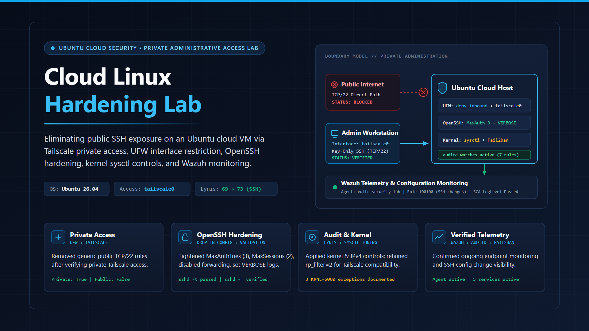
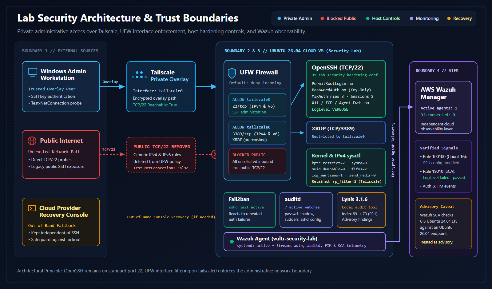
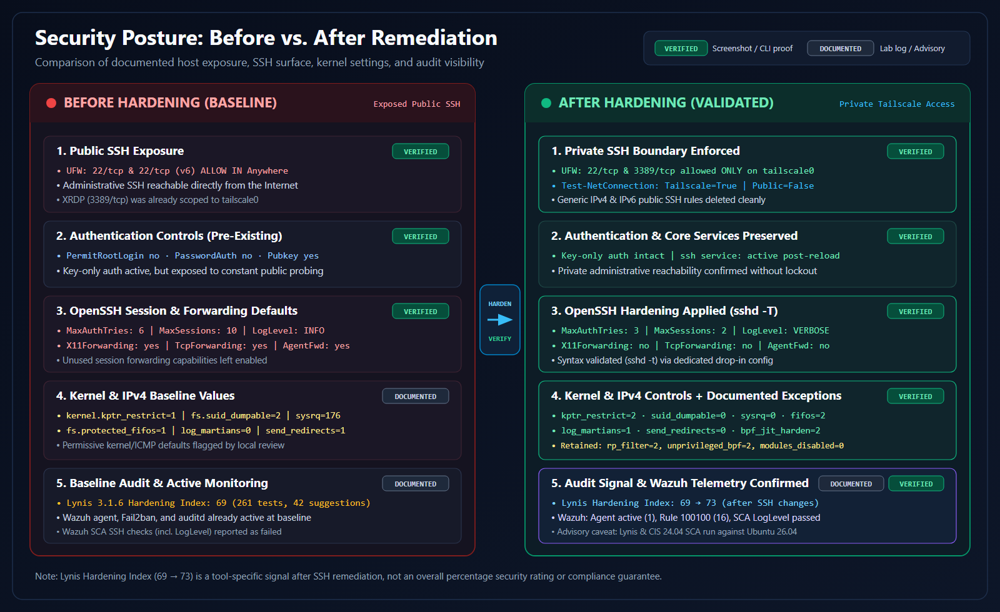
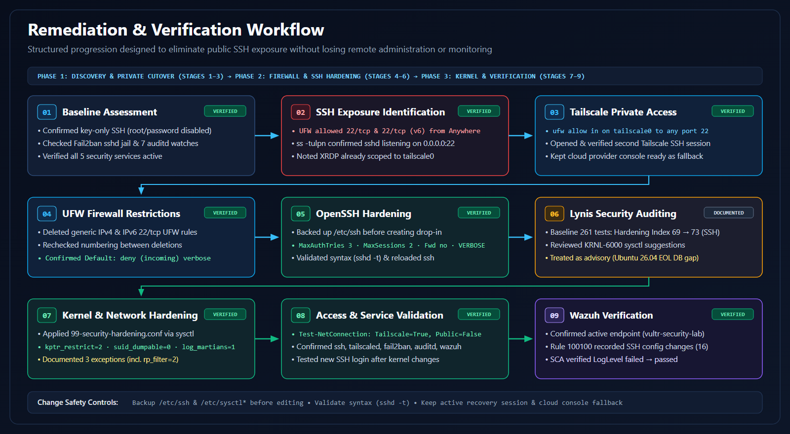
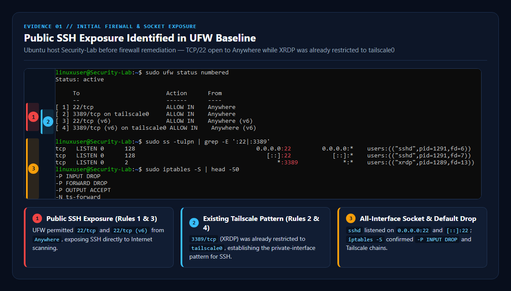
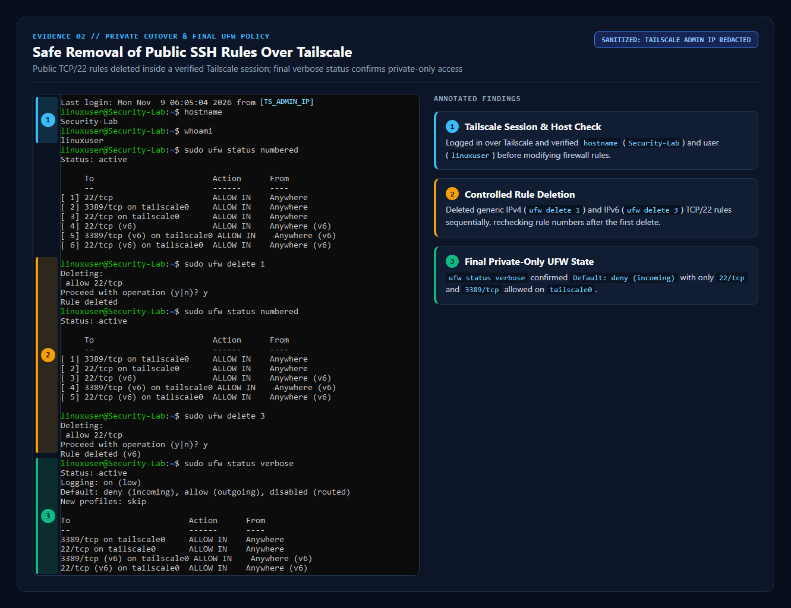
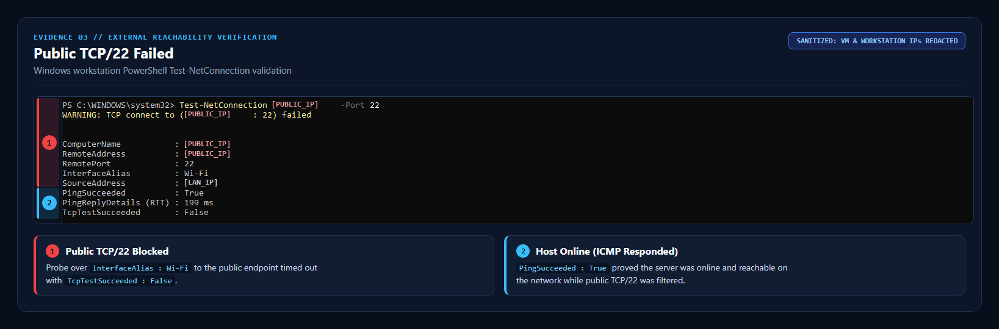
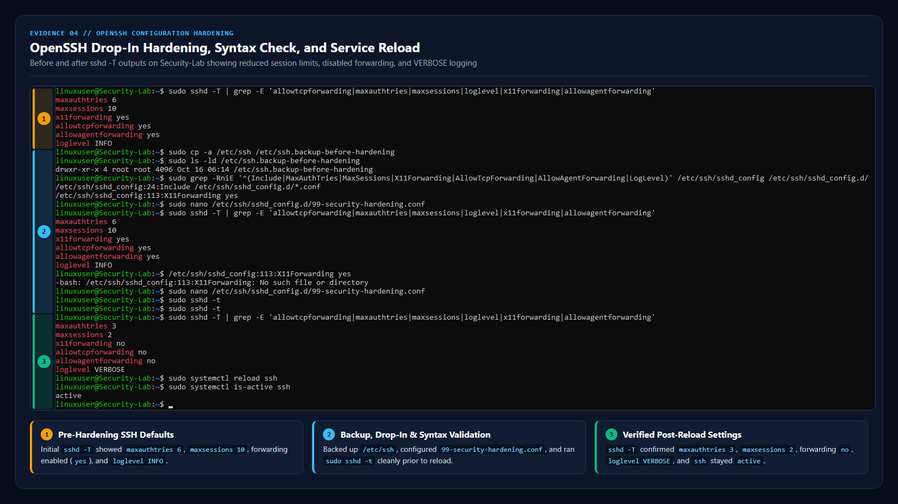
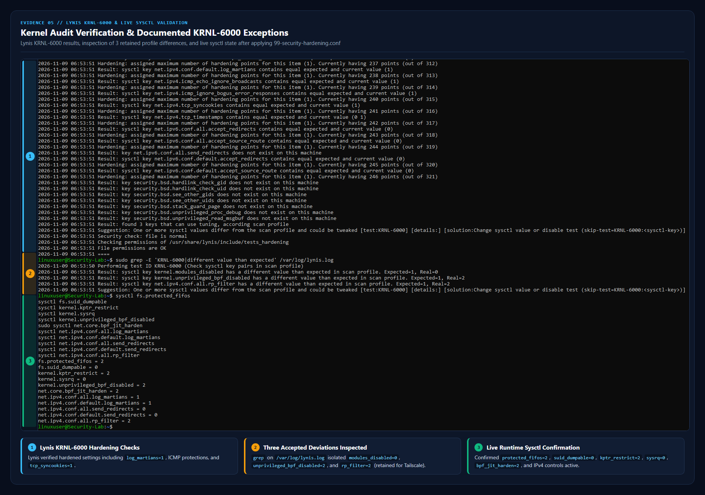
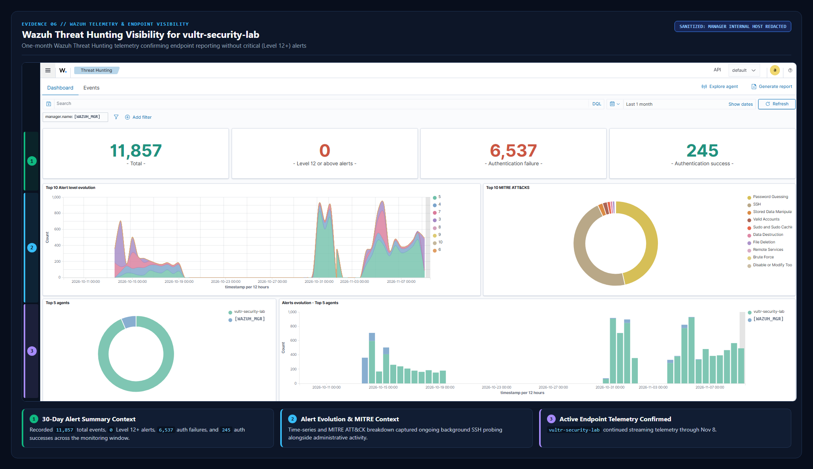

# Cloud Linux Hardening Lab



[](https://github.com/BeazerJobs-USA/Cloud-Linux-Hardening-Lab/actions/workflows/repo-checks.yml)

Ubuntu cloud VM hardening lab: I removed direct public SSH exposure by moving administrative access behind a Tailscale private overlay, tightened OpenSSH and selected kernel controls, and confirmed the Wazuh agent kept reporting after the changes.

---

## Summary

* **Host:** Ubuntu 26.04 cloud VM (`Security-Lab` / Wazuh endpoint `vultr-security-lab`).
* **Problem:** SSH was already key-only (`PermitRootLogin no`, `PasswordAuthentication no`), but **UFW still allowed TCP/22 from `Anywhere`**, so the daemon was reachable from the public Internet.
* **What I changed:** Added a UFW rule for `tailscale0`, confirmed a second private SSH session, then removed the generic IPv4 and IPv6 TCP/22 rules. Applied an OpenSSH drop-in config, tuned selected kernel and IPv4 `sysctl` values (with documented exceptions), and checked that services and monitoring stayed up.
* **Results:** `Test-NetConnection` from my workstation succeeded over Tailscale (`True`) and failed over the public path (`False`). `sshd -T` and live `sysctl` matched the intended settings. Lynis hardening index went from **69 to 73** after the SSH changes *(advisory metric)*. Wazuh recorded the SSH config changes (`Rule 100100`) and the SCA `LogLevel` check passing, with `vultr-security-lab` still active.
* **Evidence:** [Evidence Gallery](#evidence-gallery), [Troubleshooting Case Study](docs/troubleshooting-case-study.md), and command records in [`evidence/validation-evidence.md`](evidence/validation-evidence.md).

---

## Lab Environment

| Component | Detail |
| --- | --- |
| **Environment** | Controlled Ubuntu cloud VM (`Security-Lab` / agent `vultr-security-lab`) |
| **Operating System** | Ubuntu 26.04 |
| **Administrative Access** | Tailscale private overlay (`tailscale0`), key-only OpenSSH on TCP/22 |
| **Perimeter & Host Controls** | UFW (`deny incoming`), OpenSSH drop-in, Fail2ban, `auditd`, `sysctl`, Lynis 3.1.6 |
| **Monitoring Platform** | Wazuh agent streaming to an external AWS Wazuh manager |
| **Verification Approach** | Dual-path `Test-NetConnection`, `sshd -T`, live `sysctl`, `systemctl`, Wazuh telemetry |

---

## Security Objective and Key Outcomes

> **Status key:** **VERIFIED** = backed by screenshots and command output in this repo. **DOCUMENTED / ADVISORY** = recorded in my lab notes or scanner reports, with version/benchmark caveats.

| Control Area | Before | After | Status |
| --- | --- | --- | --- |
| **SSH Network Exposure** | UFW allowed `22/tcp` & `22/tcp (v6)` from `Anywhere` | Restricted to `tailscale0`; public TCP/22 blocked (`False`) | **VERIFIED** |
| **SSH Authentication** | Root & password login disabled; key-only active | Preserved unchanged; private SSH verified | **VERIFIED** |
| **OpenSSH Session Limits** | `MaxAuthTries 6`, `MaxSessions 10` | `MaxAuthTries 3`, `MaxSessions 2` | **VERIFIED** |
| **SSH Forwarding & Logs** | X11/TCP/Agent forwarding `yes`; `LogLevel INFO` | Forwarding disabled (`no`); `LogLevel VERBOSE` | **VERIFIED** |
| **Kernel & IPv4 Controls** | `kptr_restrict=1`, `suid_dumpable=2`, `sysrq=176`, `log_martians=0`, `send_redirects=1` | `kptr_restrict=2`, `suid_dumpable=0`, `sysrq=0`, `log_martians=1`, `send_redirects=0` | **VERIFIED** |
| **Accepted Exceptions** | `rp_filter=2`, `unprivileged_bpf_disabled=2`, `modules_disabled=0` | Intentionally retained for Tailscale & lab reversibility | **VERIFIED** |
| **Lynis Hardening Index** | `69` across 261 baseline tests | `73` after SSH remediation *(Lynis score, not a compliance grade)* | **DOCUMENTED** |
| **Wazuh Telemetry** | Agent active (`vultr-security-lab`) | Active (`1`), `Rule 100100` (`16`), SCA `LogLevel` passed | **VERIFIED** (dashboard) / **DOCUMENTED** (report) |

---

## Architecture Overview



OpenSSH continues listening on standard TCP/22 rather than relying on an alternate port. The security boundary is enforced at the host firewall layer (`UFW`), permitting administrative SSH and XRDP (`3389/tcp`) exclusively over `tailscale0` while dropping unsolicited public inbound traffic. See [`docs/architecture.md`](docs/architecture.md) for trust boundaries and recovery safeguards.

---

## Before-and-After Security Posture



I reviewed each scanner suggestion before changing anything. For example, `net.ipv4.conf.all.rp_filter=2` was intentionally retained to preserve compatibility with Tailscale overlay routing. See [`docs/decision-log.md`](docs/decision-log.md) and [`docs/threat-model.md`](docs/threat-model.md).

---

## Remediation Workflow



---

## Troubleshooting Case Study

How I diagnosed the public SSH exposure and fixed it without locking myself out:

1. **Original Problem:** Key-only OpenSSH remained exposed to `Anywhere` on TCP/22 alongside ongoing Internet scanning activity.
2. **Investigation:** Correlated `ufw status numbered`, `ss -tulpn`, `iptables -S`, and `sshd -T` to confirm the public exposure gap and leverage the existing `tailscale0` pattern used by XRDP.
3. **Recovery / Remediation:** Scoped SSH to `tailscale0`, validated a second private session first, sequentially removed generic IPv4/IPv6 public rules, hardened OpenSSH via drop-in config, and applied selected `sysctl` controls.
4. **Verification:** Confirmed external reachability (`Tailscale: True` vs. `Public: False`), active core services, runtime `sysctl` values, and continued Wazuh telemetry.

**[Read the full Troubleshooting Case Study](docs/troubleshooting-case-study.md)** · See also individual lab cases in [`cases/`](cases/case-001-secure-linux-baseline.md).

---

## Evidence Gallery

Cropped and annotated captures from my terminal sessions and the Wazuh dashboard. Public, Tailscale, LAN, and Wazuh manager identifiers are redacted; the uncropped originals are kept out of the repo.

### 1. Initial UFW Firewall and Listening Socket Baseline

*Before remediation: `3389/tcp` (XRDP) was already restricted to `tailscale0`, but generic `22/tcp` and `22/tcp (v6)` rules remained `ALLOW IN Anywhere` with `sshd` listening on `0.0.0.0:22` and `[::]:22`.*

### 2. Controlled Removal of Public SSH Rules Over Tailscale

*Cutover done inside an active Tailscale SSH session (`[TS_ADMIN_IP]` redacted). Generic IPv4 and IPv6 `22/tcp` rules were removed one at a time, rechecking rule numbers in between, leaving `Default: deny (incoming)` with only `22/tcp` and `3389/tcp` allowed on `tailscale0`.*

### 3. External Reachability Check: Public Path

*Run from my Windows workstation (public IP and LAN IP redacted). `Test-NetConnection` to the VM's public address on port 22 failed over `Wi-Fi` (`TcpTestSucceeded : False`) while `PingSucceeded : True` showed the server was still online. The Tailscale-path test from the same session (`TcpTestSucceeded : True`) is in the [text record](evidence/validation-evidence.md#7-private-versus-public-tcp22-validation).*

### 4. OpenSSH Hardening, Syntax Validation, and Reload

*`/etc/ssh` backup, drop-in configuration in `/etc/ssh/sshd_config.d/99-security-hardening.conf`, clean `sshd -t` validation, and `sshd -T` verification (`MaxAuthTries 3`, `MaxSessions 2`, forwarding disabled, `LogLevel VERBOSE`) with `ssh` remaining `active`.*

### 5. Lynis `KRNL-6000` Audit and Live `sysctl` Verification

*Lynis `KRNL-6000` sysctl checks, inspection of the three intentionally retained deviations in `/var/log/lynis.log` (`modules_disabled=0`, `unprivileged_bpf_disabled=2`, `rp_filter=2`), and live `sysctl` confirmation of all applied hardening values.*

### 6. Wazuh Monitoring Telemetry

*One-month Wazuh Threat Hunting view (manager hostname redacted to `[WAZUH_MGR]`) for `vultr-security-lab`: `11,857` events, `6,537` authentication failures, and `0` Level 12+ alerts. The alert charts show quiet periods around Oct 19–30 and Nov 2–3.*

---

## Technical Implementation and Validation

* **Configuration Artifacts:** [`configs/99-ssh-security-hardening.conf`](configs/99-ssh-security-hardening.conf) and [`configs/99-security-hardening.conf`](configs/99-security-hardening.conf)
* **Automated Host Verification Script:** [`scripts/validate-host.sh`](scripts/validate-host.sh) (read-only checks for effective `sshd -T`, service status, `sysctl`, UFW, Fail2ban, and `auditd`; syntax-checked via [`.github/workflows/repo-checks.yml`](.github/workflows/repo-checks.yml))
* **Wazuh & Lynis Analysis:** [`docs/monitoring-validation.md`](docs/monitoring-validation.md), [`evidence/wazuh-validation.md`](evidence/wazuh-validation.md), and [`evidence/lynis/README.md`](evidence/lynis/README.md) — covering Wazuh Overview (`Active: 1`, `Disconnected: 0`), exported Threat Hunting report (`Rule 100100` count `16`), and SCA `LogLevel` status changing from `failed` to `passed`.
* **Reproduction Guide:** [`docs/reproduction.md`](docs/reproduction.md)

---

## Documentation Navigation

| Topic | Documentation & Artifacts |
| --- | --- |
| **Case Studies** | [`docs/troubleshooting-case-study.md`](docs/troubleshooting-case-study.md) · [`case-001`](cases/case-001-secure-linux-baseline.md) · [`case-002`](cases/case-002-private-administrative-access.md) · [`case-003`](cases/case-003-security-audit-and-remediation.md) |
| **Architecture & Design** | [`docs/architecture.md`](docs/architecture.md) · [`docs/decision-log.md`](docs/decision-log.md) · [`docs/threat-model.md`](docs/threat-model.md) |
| **Validation & Monitoring** | [`evidence/README.md`](evidence/README.md) · [`evidence/validation-evidence.md`](evidence/validation-evidence.md) · [`evidence/wazuh-validation.md`](evidence/wazuh-validation.md) · [`docs/monitoring-validation.md`](docs/monitoring-validation.md) |
| **Hardening & Reproduction** | [`configs/99-ssh-security-hardening.conf`](configs/99-ssh-security-hardening.conf) · [`configs/99-security-hardening.conf`](configs/99-security-hardening.conf) · [`scripts/validate-host.sh`](scripts/validate-host.sh) · [`docs/reproduction.md`](docs/reproduction.md) |
| **Visual Assets** | [`assets/project-cover.svg`](assets/project-cover.svg) · [`assets/architecture/`](assets/architecture/lab-architecture.svg) · [`assets/diagrams/`](assets/diagrams/security-posture-before-after.svg) · [`assets/evidence/`](assets/evidence/01-ufw-exposure-baseline.png) |

<details>
<summary>Repository File Tree</summary>

```text
Cloud-Linux-Hardening-Lab/
├── README.md
├── SECURITY.md
├── .github/workflows/repo-checks.yml
├── assets/
│   ├── project-cover.png / .svg
│   ├── architecture/
│   │   └── lab-architecture.png / .svg
│   ├── diagrams/
│   │   ├── remediation-workflow.png / .svg
│   │   └── security-posture-before-after.png / .svg
│   └── evidence/
│       ├── 01-ufw-exposure-baseline.png
│       ├── 02-ufw-private-ssh-cutover.png
│       ├── 03-private-vs-public-ssh-validation.png
│       ├── 04-openssh-hardening-validation.png
│       ├── 05-lynis-krnl-and-sysctl-validation.png
│       └── 06-wazuh-monitoring-validation.png
├── cases/
│   ├── case-001-secure-linux-baseline.md
│   ├── case-002-private-administrative-access.md
│   └── case-003-security-audit-and-remediation.md
├── configs/
│   ├── 99-security-hardening.conf
│   └── 99-ssh-security-hardening.conf
├── docs/
│   ├── architecture.md
│   ├── decision-log.md
│   ├── monitoring-validation.md
│   ├── reproduction.md
│   ├── threat-model.md
│   └── troubleshooting-case-study.md
├── evidence/
│   ├── README.md
│   ├── validation-evidence.md
│   ├── wazuh-validation.md
│   └── lynis/README.md
└── scripts/
    └── validate-host.sh
```

</details>

---

## Scope and Limitations

* **Controlled Lab Environment:** This repository documents a cloud hardening lab rather than a formal compliance certification or production deployment claim.
* **Scanner Compatibility Caveats:** Lynis 3.1.6 reported that its build was more than six months old and lacked an end-of-life database entry for Ubuntu 26.04. Wazuh Security Configuration Assessment evaluated a CIS Ubuntu 24.04 LTS v1.0.0 benchmark against an Ubuntu 26.04 host. Both scanner outputs are treated as advisory engineering signals rather than authoritative compliance grades.
* **Incident Scope:** Authentication failure counts and brute-force telemetry reported by Fail2ban and Wazuh reflect background Internet probing context; this project does not claim exploitation, malware infection, compromise, or incident containment.
* **Sanitization Policy:** See [`SECURITY.md`](SECURITY.md) for excluded secrets and redaction rules.
