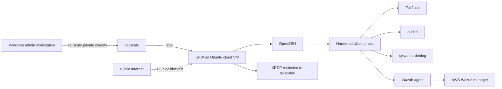

# Cloud Linux Hardening Lab

A hands on Ubuntu cloud security project that reduces remote attack surface, moves administration to a private access path, hardens SSH and kernel controls, and validates every major change through connectivity tests, service checks, Lynis, auditd, Fail2ban, and Wazuh.

## 60 second review

**Problem:** The host already used key only SSH with root login disabled, but TCP/22 was still allowed from anywhere by UFW.

**Design change:** Administrative SSH was moved behind Tailscale and the generic public SSH rules were removed.

**Hardening:** OpenSSH session controls and forwarding features were tightened. Selected kernel and IPv4 settings were hardened after a Lynis audit.

**Validation:** Private SSH remained reachable, public TCP/22 failed, core security services stayed active, and Wazuh continued to record endpoint activity and SSH configuration changes.

**Measured result:** Lynis hardening index improved from **69 to 73** after SSH remediation. Remaining scanner deviations were reviewed and documented instead of changed blindly.

## What I implemented

| Control area | Before | After |
| --- | --- | --- |
| SSH network exposure | TCP/22 allowed from anywhere | TCP/22 restricted to `tailscale0`; public TCP/22 blocked |
| Root SSH login | Disabled | Disabled |
| Password SSH login | Disabled | Disabled |
| Public key SSH | Enabled | Enabled |
| Max authentication attempts | 6 | 3 |
| SSH sessions per connection | 10 | 2 |
| X11 forwarding | Enabled | Disabled |
| TCP forwarding | Enabled | Disabled |
| Agent forwarding | Enabled | Disabled |
| SSH logging | INFO | VERBOSE |
| Kernel pointer exposure | `kernel.kptr_restrict=1` | `kernel.kptr_restrict=2` |
| Setuid core dumps | `fs.suid_dumpable=2` | `fs.suid_dumpable=0` |
| Suspicious IPv4 logging | Disabled | Enabled with `log_martians=1` |
| ICMP redirects | Enabled | Disabled |
| Lynis hardening index | 69 | 73 after SSH remediation |
| Monitoring | Wazuh agent active | Wazuh remained active and recorded SSH configuration changes |

## Architecture



The security boundary is not a nonstandard SSH port. OpenSSH still listens on port 22, while UFW controls which interface can reach it.

## Security engineering decisions

| Decision | Why | How it was validated |
| --- | --- | --- |
| Restrict SSH to Tailscale | Remove direct Internet administration without losing remote access | Tailscale TCP/22 succeeded while public TCP/22 failed |
| Keep SSH on port 22 | Port changes do not replace access control | Public reachability was removed at the firewall layer |
| Disable unused SSH forwarding features | Reduce unnecessary capability available to authenticated sessions | `sshd -T` confirmed effective values |
| Increase SSH logging to VERBOSE | Improve authentication context for investigation | Effective OpenSSH configuration and Wazuh telemetry were checked |
| Keep `rp_filter=2` | Preserve compatibility with overlay and asymmetric networking behavior | Tailscale connectivity succeeded after sysctl changes |
| Keep `kernel.unprivileged_bpf_disabled=2` | Unprivileged BPF remains disabled while the setting remains administratively reversible | Value was rechecked after remediation |
| Keep `kernel.modules_disabled=0` | Avoid permanently blocking module loading until reboot in a learning lab | Documented as an accepted Lynis deviation |

See [docs/decision-log.md](docs/decision-log.md) for the complete reasoning.

## Evidence and validation

The public repo uses sanitized command outputs instead of raw desktop screenshots. This keeps the proof reviewable without publishing public IP addresses, Tailscale addresses, private keys, credentials, or unrelated workstation content.

The primary evidence record is [evidence/validation-evidence.md](evidence/validation-evidence.md). It contains:

1. SSH authentication baseline
2. Fail2ban activity
3. auditd watch rules
4. active security services
5. initial UFW exposure
6. Tailscale only SSH validation
7. OpenSSH values before and after hardening
8. Lynis hardening index change
9. kernel and network values before and after remediation
10. residual Lynis deviations and accepted exceptions
11. Wazuh monitoring validation after hardening

## Wazuh monitoring validation

Wazuh remained an independent observability layer throughout the hardening work.

The exported threat hunting report recorded:

```text
Rule 100100
SSH configuration file modified on
Level 8
Count 16
```

Wazuh Security Configuration Assessment also recorded several SSH controls changing from failed to passed, including `LogLevel`, which directly corresponds to the change from INFO to VERBOSE in this project.

See [docs/monitoring-validation.md](docs/monitoring-validation.md).

## Case documentation

1. [Case 001: Secure Linux Baseline and Host Controls](cases/case-001-secure-linux-baseline.md)
2. [Case 002: Private Administrative Access](cases/case-002-private-administrative-access.md)
3. [Case 003: Security Audit and Remediation](cases/case-003-security-audit-and-remediation.md)

Each case follows the same pattern: initial condition, security concern, implementation, validation, tradeoff, and outcome.

## Configuration artifacts

The repository includes the exact security settings used for the completed remediation:

* [`configs/99-ssh-security-hardening.conf`](configs/99-ssh-security-hardening.conf)
* [`configs/99-security-hardening.conf`](configs/99-security-hardening.conf)

These are lab artifacts, not universal baselines. They should be reviewed against another host's role, networking, and operational requirements before reuse.

## Reproduction

[docs/reproduction.md](docs/reproduction.md) documents the implementation and validation sequence using placeholder addresses.

[docs/architecture.md](docs/architecture.md) documents the trust boundaries and control placement.

## Repository structure

```text
Cloud-Linux-Hardening-Lab/
├── README.md
├── SECURITY.md
├── cases/
│   ├── case-001-secure-linux-baseline.md
│   ├── case-002-private-administrative-access.md
│   └── case-003-security-audit-and-remediation.md
├── configs/
│   ├── 99-security-hardening.conf
│   └── 99-ssh-security-hardening.conf
├── docs/
│   ├── architecture.md
│   ├── decision-log.md
│   ├── monitoring-validation.md
│   └── reproduction.md
└── evidence/
    ├── README.md
    ├── validation-evidence.md
    └── lynis/
        └── README.md
```

## Skills demonstrated

Ubuntu Linux administration, OpenSSH hardening, Tailscale private administration, UFW firewall policy, Fail2ban, auditd, Wazuh endpoint monitoring, Lynis auditing, sysctl hardening, configuration validation, connectivity testing, evidence handling, change safety, and risk based remediation.

## Scope and limitations

This is a controlled cloud lab, not a claim of production deployment or formal compliance.

Lynis 3.1.6 reported that its version was more than six months old and did not have an end of life database entry for Ubuntu 26.04. Wazuh Security Configuration Assessment referenced a CIS Ubuntu 24.04 benchmark while the host was Ubuntu 26.04. Those scanner results were therefore treated as advisory evidence.

The project does not claim exploitation, malware activity, compromise, or incident containment that did not occur.
