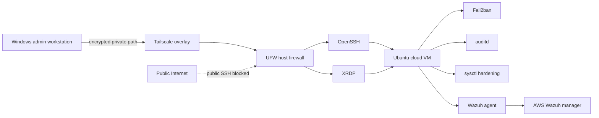

# Architecture and Trust Boundaries

## Logical architecture

## Trust boundaries

### Public network boundary

The VM has a public interface because it is a cloud host, but administrative SSH is not permitted through that path after remediation. UFW is the host level enforcement point.

### Private administrative boundary

Tailscale provides the path used for SSH administration. The Windows workstation must participate in the private overlay before it can reach the permitted SSH path.

### Host boundary

The Ubuntu VM applies defense in depth controls after the connection reaches the host:

- OpenSSH configuration restricts authentication and session capabilities.
- Fail2ban reacts to repeated SSH authentication failures.
- auditd monitors changes to identity, privilege, and SSH configuration files.
- sysctl settings harden selected kernel and IPv4 behavior.
- Wazuh provides endpoint telemetry and file integrity monitoring to the separate manager.

## Recovery consideration

Changes to remote access controls were made only after a second private access path was validated. The cloud provider console remained the out of band recovery path if a firewall or SSH configuration change caused lockout.
