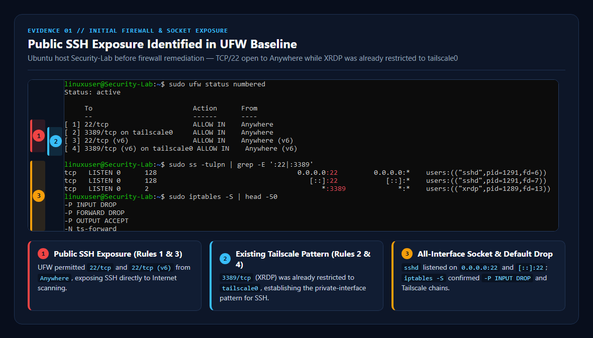
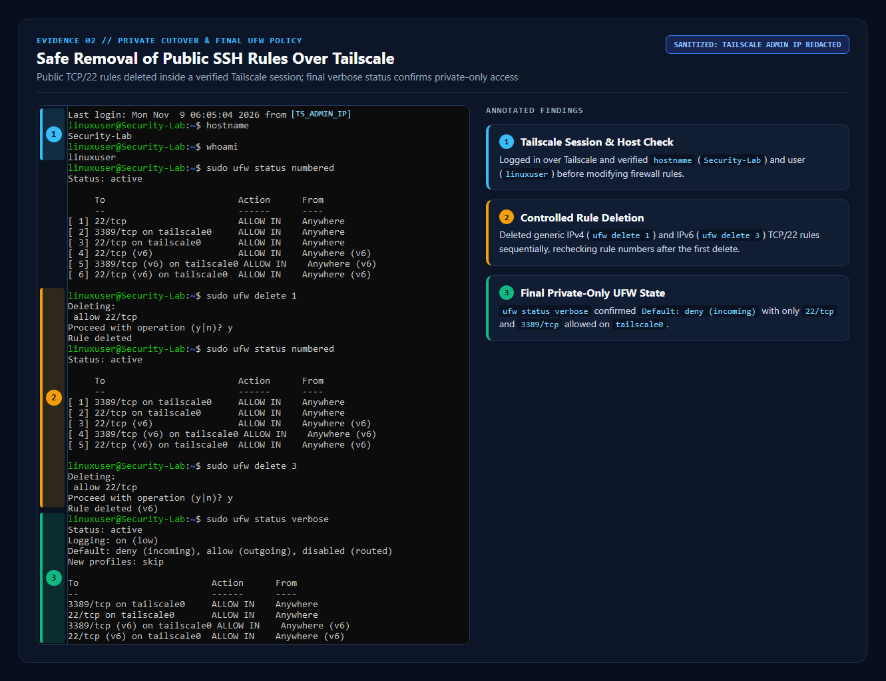
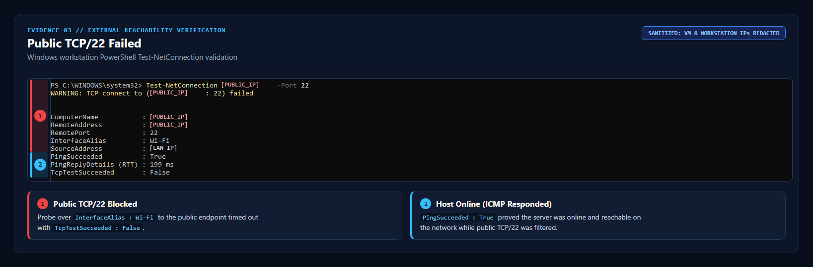

# Troubleshooting Case Study: Eliminating Public SSH Exposure Without Administrative Lockout

This case study documents how direct Internet SSH exposure on an Ubuntu 26.04 cloud server (`Security-Lab` / Wazuh agent `vultr-security-lab`) was diagnosed, safely migrated behind a Tailscale private overlay, hardened at the SSH and kernel layers, and verified without losing administrative access or disconnecting the Wazuh agent.

> **Status key:** **VERIFIED** = confirmed in the screenshots and command logs in [`../evidence/`](../evidence/) and [`../assets/evidence/`](../assets/evidence/). **DOCUMENTED / ADVISORY** = recorded in my lab notes or scanner output, with the caveats noted.

---

## 1. Original Problem

At initial inspection, the Ubuntu cloud server already enforced strong SSH authentication controls:

* `PermitRootLogin no`
* `PasswordAuthentication no`
* `PubkeyAuthentication yes`
* Active Fail2ban `sshd` jail, active `auditd` watches, and an active `wazuh-agent`

However, **TCP/22 remained publicly reachable from the Internet** through generic UFW allow rules for both IPv4 and IPv6 (`22/tcp ALLOW IN Anywhere`).

### Why This Was a Security Concern

Strong authentication reduces credential-guessing risk, but it does not eliminate network-layer exposure:

1. **Public service reachability:** Keeping TCP/22 open to `Anywhere` exposed the OpenSSH daemon directly to continuous Internet scanning and authentication probing (documented in Fail2ban's baseline counter of `2,147` failed attempts / `25` bans and Wazuh's 30-day context of `6,508` non-existent user attempts under `Rule 5710`).
2. **Expanded blast radius:** If an OpenSSH vulnerability or misconfiguration occurred, any public Internet host could reach the daemon directly.
3. **Lockout risk during remediation:** Removing public TCP/22 rules remotely over SSH could sever administrative access immediately if a verified private access path were not established and tested first.

---

## 2. Investigation

The initial host state was inspected using read-only validation commands before changing any firewall or daemon configuration:

| Layer Inspected | Command Used | Observed Finding | Status |
| --- | --- | --- | --- |
| **SSH authentication** | `sudo sshd -T \| grep -E 'permitrootlogin\|passwordauthentication\|pubkeyauthentication'` | Key-only auth already active; root and password logins disabled | **VERIFIED** |
| **UFW firewall policy** | `sudo ufw status numbered` | Rules `[1]` & `[3]` allowed `22/tcp` & `22/tcp (v6)` from `Anywhere`; `[2]` & `[4]` already scoped `3389/tcp` (XRDP) to `tailscale0` | **VERIFIED** |
| **Listening sockets** | `sudo ss -tulpn \| grep -E ':22\|:3389'` | `sshd` bound to `0.0.0.0:22` and `[::]:22` | **VERIFIED** |
| **Packet filter policy** | `sudo iptables -S \| head -50` | Default `-P INPUT DROP` with UFW and Tailscale (`ts-*`) chains present | **VERIFIED** |
| **OpenSSH session settings** | `sudo sshd -T \| grep -E 'allowtcpforwarding\|maxauthtries\|maxsessions\|loglevel\|x11forwarding\|allowagentforwarding'` | `maxauthtries 6`, `maxsessions 10`, X11/TCP/agent forwarding `yes`, `loglevel INFO` | **VERIFIED** |



### Key Investigation Insight

Because **XRDP (`3389/tcp`) was already restricted to `tailscale0`**, Tailscale was confirmed as an operational private network path on the host. The firewall gap existed because generic public SSH rules had not yet been scoped to the private interface, and OpenSSH still permitted unnecessary forwarding features and higher session limits.

---

## 3. Recovery / Remediation

To remove public SSH exposure without risking administrative lockout, changes were applied in a controlled sequence with safety fallbacks at each step.

### Change-Safety Safeguards

* **Out-of-band fallback:** Kept the cloud provider recovery console available throughout firewall and SSH changes.
* **Two-session rule:** Opened and verified a second SSH connection over Tailscale before removing any public firewall entry.
* **Configuration backups:** Created backups of `/etc/ssh`, `/etc/sysctl.conf`, and `/etc/sysctl.d` prior to editing.
* **Pre-reload validation:** Tested OpenSSH syntax (`sudo sshd -t`) before reloading the SSH service.

### Step-by-Step Remediation

1. **Permit SSH on `tailscale0` and test private login:**
   ```bash
   sudo ufw allow in on tailscale0 to any port 22 proto tcp
   ```
   A fresh SSH session was opened over Tailscale, confirming `hostname` (`Security-Lab`) and `whoami` (`linuxuser`).

2. **Remove generic public IPv4 and IPv6 TCP/22 rules safely:**
   Because UFW dynamically renumbers rules after each deletion, `sudo ufw status numbered` was re-checked between deletions (`sudo ufw delete 1` for IPv4, followed by `sudo ufw delete 3` for IPv6).

   

3. **Harden OpenSSH session and logging defaults:**
   Placed [`99-ssh-security-hardening.conf`](../configs/99-ssh-security-hardening.conf) at `/etc/ssh/sshd_config.d/99-security-hardening.conf` after backing up `/etc/ssh`:
   * Tightened `MaxAuthTries` from `6` → `3` and `MaxSessions` from `10` → `2`
   * Disabled `X11Forwarding`, `AllowTcpForwarding`, and `AllowAgentForwarding`
   * Increased `LogLevel` from `INFO` → `VERBOSE`
   * Validated with `sudo sshd -t` and applied via `sudo systemctl reload ssh`

4. **Apply selected kernel & IPv4 hardening with compatibility checks:**
   Following a Lynis 3.1.6 audit (baseline index `69`, rising to `73` after SSH changes), applied [`99-security-hardening.conf`](../configs/99-security-hardening.conf) (`fs.protected_fifos=2`, `fs.suid_dumpable=0`, `kernel.kptr_restrict=2`, `kernel.sysrq=0`, `net.core.bpf_jit_harden=2`, `log_martians=1`, `send_redirects=0`).
   Three `KRNL-6000` scanner differences were intentionally retained instead of changed blindly:
   * `net.ipv4.conf.all.rp_filter=2` — loose reverse-path filtering preserved to avoid disrupting Tailscale overlay routing.
   * `kernel.unprivileged_bpf_disabled=2` — keeps unprivileged BPF disabled while preserving administrative reversibility.
   * `kernel.modules_disabled=0` — retains module loading flexibility in this lab without requiring a reboot.

---

## 4. Verification

Every layer of the remediation was checked after cutover to verify network isolation, administrative continuity, host configuration state, and telemetry visibility.

| Verification Check | Outcome Observed | Classification | Evidence Source |
| --- | --- | --- | --- |
| **Final UFW policy (`ufw status verbose`)** | `Default: deny (incoming)`; only `22/tcp` & `3389/tcp` (IPv4 & IPv6) permitted on `tailscale0` | **VERIFIED** | [`02-ufw-private-ssh-cutover.png`](../assets/evidence/02-ufw-private-ssh-cutover.png) |
| **External reachability (`Test-NetConnection`)** | Tailscale TCP/22: `TcpTestSucceeded : True`; Public Wi-Fi TCP/22: `TcpTestSucceeded : False` (`PingSucceeded : True` confirmed host online) | **VERIFIED** | [`03-private-vs-public-ssh-validation.png`](../assets/evidence/03-private-vs-public-ssh-validation.png) (public path) · [`validation-evidence.md`](../evidence/validation-evidence.md#7-private-versus-public-tcp22-validation) (both paths) |
| **Effective OpenSSH settings (`sshd -T`)** | Confirmed `maxauthtries 3`, `maxsessions 2`, forwarding `no`, `loglevel VERBOSE`, and `ssh` service `active` | **VERIFIED** | [`04-openssh-hardening-validation.png`](../assets/evidence/04-openssh-hardening-validation.png) |
| **Kernel `sysctl` & Lynis `KRNL-6000`** | Live `sysctl` matched intended hardening values; 3 retained `KRNL-6000` deviations documented | **VERIFIED** | [`05-lynis-krnl-and-sysctl-validation.png`](../assets/evidence/05-lynis-krnl-and-sysctl-validation.png) |
| **Core host services & post-change login** | `ssh`, `tailscaled`, `fail2ban`, `auditd`, and `wazuh-agent` all `active`; new Tailscale SSH session succeeded | **DOCUMENTED** | [`validation-evidence.md`](../evidence/validation-evidence.md) · [`case-003`](../cases/case-003-security-audit-and-remediation.md) |
| **Lynis hardening index change** | Index changed from `69` to `73` after SSH remediation across `261` tests (treated as advisory due to Lynis 3.1.6 / Ubuntu 26.04 EOL DB gap) | **DOCUMENTED / ADVISORY** | [`lynis/README.md`](../evidence/lynis/README.md) |
| **Wazuh monitoring & SCA visibility** | Threat Hunting dashboard active for `vultr-security-lab` (`11,857` total events, `0` Level 12+); Overview `Active (1)` / `Disconnected (0)`; PDF report recorded custom `Rule 100100` (`Count 16`) and SCA `Rule 19010` (`LogLevel` failed→passed) | **VERIFIED** (dashboard) / **DOCUMENTED** (report) | [`06-wazuh-monitoring-validation.png`](../assets/evidence/06-wazuh-monitoring-validation.png) · [`07-wazuh-agent-status.png`](../assets/evidence/07-wazuh-agent-status.png) · [`wazuh-validation.md`](../evidence/wazuh-validation.md) |



### Key Engineering Takeaway

The primary security boundary in this remediation is **interface-level firewall enforcement combined with a private overlay (`tailscale0`)**, rather than moving SSH to a nonstandard port. By validating a second private session before rule deletion and retaining `rp_filter=2` for overlay routing compatibility, public SSH exposure was removed while keeping administrative access and the Wazuh agent connected.

---

## Related Documentation

* [Decision Log](decision-log.md) — Engineering rationale for retained defaults (`rp_filter=2`, port `22`, etc.)
* [Architecture & Trust Boundaries](architecture.md) — Boundary placement across workstation, overlay, host, and SIEM
* [Monitoring Validation](monitoring-validation.md) — Wazuh reporting scope and CIS benchmark caveat
* [Sanitized Validation Evidence](../evidence/validation-evidence.md) — Complete command transcripts
